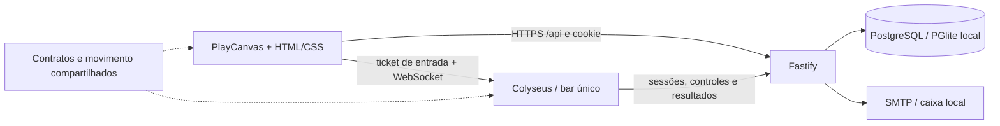

# Arquitetura

O cliente apresenta o mundo e envia intenções; não distribui cartas, decide resultados, concede privilégios ou determina posições autoritativas. Colyseus mantém uma instância principal persistente, inclusive vazia. Ao lotar, novas criações são recusadas e o cliente consulta novamente a disponibilidade.

A API valida e grava dados com Drizzle. O mesmo schema PostgreSQL é usado pelo driver `pg` em produção e pelo PGlite persistente no desenvolvimento local. Senhas são Argon2id; tokens de sessão, confirmação e recuperação são aleatórios e apenas seus hashes são persistidos. Tickets de jogo são HMAC, duram 60 segundos e são consumidos uma única vez.

O jogo revalida sessões a cada três segundos e ao reconectar. Bloqueios são aplicados no servidor de chat. Privilégios administrativos são lidos da conta no banco, nunca de um comando do navegador. Ações privilegiadas têm auditoria persistente; os logs operacionais do jogo são JSON em stdout.

As tabelas de estatísticas aceitam cada resultado `(roundId,userId)` uma única vez. O servidor mantém uma fila de repetição quando a API está indisponível. Essa fila ainda é volátil: encerrar o processo antes de persistir pode perder a estatística da rodada. A fila administrativa é persistente e consumida atomicamente, mas não possui confirmação de aplicação; uma queda após o consumo pode perder um comando transitório. Banimentos também revogam sessões e continuam efetivos.

O cenário ativo vem dos exports de `assets-bar/map/BarBoteco`. O importador gera `packages/shared/src/map-data.json`; `world.ts` usa essas dimensões e superfícies para colisões, escada, alturas, câmera, nascimento e interações. A altura dos jogadores e NPCs é sincronizada; o cliente continua enviando apenas intenções horizontais. NPCs percorrem pontos predefinidos e reagem ao evento global. O agendador mantém um evento por vez; mudanças administrativas substituem o evento atual. O blackjack é independente desse agendador. Veja [integração do mapa](../assets/map.md).

O nginx serve o cliente e encaminha `/api` e `/game`. Rotas internas e a caixa local de e-mails são bloqueadas no proxy de produção. TLS é encerrado no proxy externo da hospedagem. Não há microsserviços distribuídos, Redis ou Kubernetes nesta versão.

Referências consultadas: [PlayCanvas Engine](https://api.playcanvas.com/engine/), [salas Colyseus](https://docs.colyseus.io/server/room), [sincronização](https://docs.colyseus.io/state), [Drizzle com PGlite](https://orm.drizzle.team/docs/get-started/pglite-new), [Nodemailer SMTP](https://nodemailer.com/smtp).

A skin vestida é persistida no perfil, separada do inventário. Nathan é gratuito; as demais skins são compradas. A API valida compras e posse em transações; o servidor sincroniza a skin autorizada para os clientes. Cada skin mantém seu modelo, rig e banco de animações. Veja [skins e coleção](../sistemas/skins.md).
