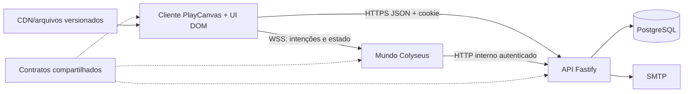

# Arquitetura recomendada

## Forma geral

Manter um **monólito modular distribuído em três processos**: cliente, API e mundo. Não introduzir Redis, Kafka, Kubernetes ou microsserviços no MVP.



## Fronteiras

- Cliente: input, predição, apresentação, áudio, cache e UI. Nunca decide saldo, posse, resultado ou posição final.
- Mundo: simulação de alta frequência, presença, ocupação, interações instantâneas, NPCs e minijogos.
- API: identidade, sessão, autorização, economia, inventário, perfil, denúncias e auditoria durável.
- Shared: schemas de mensagens, IDs, regras puras determinísticas e catálogos públicos. Sem acesso a DOM, banco ou ambiente.
- PostgreSQL: fonte durável. Toda alteração de valor gera ledger/outbox na mesma transação.

## Estrutura alvo

```text
apps/web/src/
  app/             sessão, roteamento e composição
  game/            input, networking, prediction
  world/           scene host e sistemas PlayCanvas
  features/        admin, chat, inventory, media, wardrobe
  ui/              componentes DOM, toast, focus, accessibility
apps/server/src/
  room/            lifecycle e roteamento de mensagens
  systems/         movement, interaction, needs, media, moderation
  activities/      blackjack, jobs, events
apps/api/src/
  modules/         auth, profile, economy, inventory, moderation
  platform/        database, mail, config, observability
packages/shared/src/
  contracts/       schemas versionados
  gameplay/        regras puras
  content/         catálogos validados
content/           definições versionadas de itens, jobs, NPCs, mapa
assets-src/        fontes fora do bundle, com licença/procedência
tools/             importação determinística
tests/             contract, integration, e2e, performance
docs/adr/          decisões arquiteturais
infra/             imagens, proxy, migrations, runbooks
```

Não mover tudo de uma vez. Extrair um sistema por PR, mantendo fachadas `BarScene`, `BarRoom` e app até consumidores migrarem.

## Framework universal de interação

Contrato orientado a dados:

```ts
type InteractionDefinition = {
  id: string; kind: string; position: Position; maxDistance: number;
  priority: number; occupancy?: { slots: number };
  requirements?: string[]; action: string;
};
type InteractionIntent = { interactionId: string; requestId: string };
```

O cliente faz seleção/raycast e feedback; o mundo revalida distância, estado, ocupação, cooldown e permissões, então emite resultado. Reservas têm proprietário, expiração e cancelamento. Animação e prop são consequências do estado autoritativo, não gatilhos de regra.

## Mensagens e estados

- Todo comando mutável recebe schema estrito, limite de tamanho, `requestId` quando repetível e erro estável.
- Mudanças incompatíveis usam versão de contrato e janela de compatibilidade.
- Eventos duráveis API↔mundo usam transactional outbox com `pending/leased/applied/failed`.
- Estado público não inclui carteira, inventário privado, e-mail ou cartas ocultas.
- Métricas: latência de tick/patch, fila, conexões, rejeições, erros, tempo de DB e uso de memória.

## Lifecycle e recursos

Cada sistema cliente implementa `start/update/stop/destroy`; cada asset tem proprietário claro. `destroy` cancela timers, listeners, promises antigas, WebAudio, materiais e entidades. Sistemas do mundo implementam `onJoin/onLeave/update/snapshot` sem acessar diretamente internals de outros sistemas.

## ADRs iniciais

1. ADR-001 manter PlayCanvas e critérios de reavaliação.
2. ADR-002 monólito modular e limites entre API/mundo.
3. ADR-003 autoridade e idempotência.
4. ADR-004 pipeline glTF e convenções de mapa.
5. ADR-005 rig canônico + adaptadores por rig.
6. ADR-006 economia sem dinheiro real.
7. ADR-007 políticas de privacidade/moderação.

